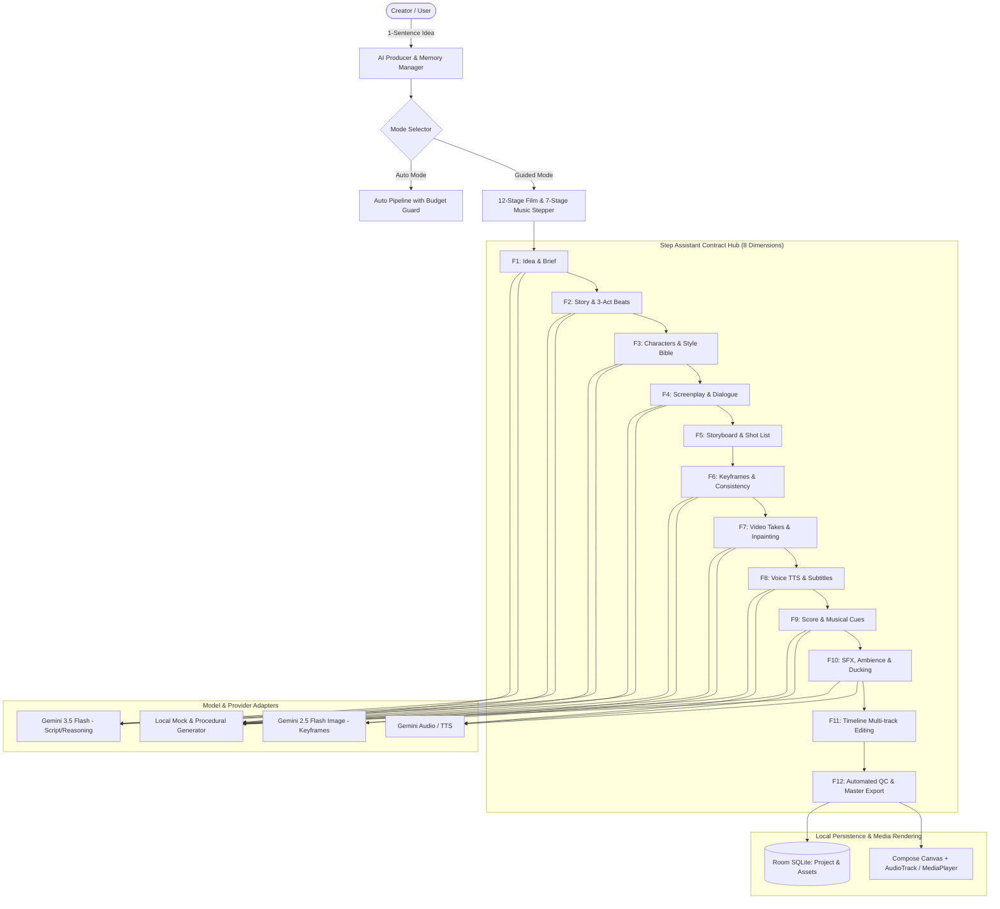

# CineSonic Studio: Architecture & Technical Plan

## 1. System Architecture

## 2. Data Models (Entities & Schemas)

- **Project**: `id`, `title`, `ideaPrompt`, `mode` (Guided/Auto), `createdAt`, `budgetLimit`, `budgetSpent`, `filmStep`, `musicStep`
- **Brief**: `genre`, `targetAudience`, `tone`, `durationSec`, `primaryLanguage`, `budgetCeiling`, `concepts` (List of 3)
- **StoryVersion**: `version`, `logline`, `synopsis`, `threeActBeats` (Setup, Inciting Incident, Midpoint, Climax, Resolution), `critiqueScore`
- **Character**: `id`, `name`, `role`, `appearancePrompt`, `voicePitch`, `costumeNotes`, `consistencyTokens`
- **StyleBible**: `visualStyle`, `colorPalette` (hex codes), `lightingPreset`, `aspectRatio`, `negativePrompt`
- **Scene**: `sceneIndex`, `heading`, `setting`, `timeOfDay`, `summary`
- **Shot**: `shotIndex`, `sceneIndex`, `shotType` (Wide, Medium, Close-up), `cameraAngle`, `cameraMotion`, `durationSec`, `prompt`, `dialogue`, `subtitles`
- **Take**: `takeIndex`, `shotIndex`, `videoUrlOrSyntheticId`, `keyframeBitmap`, `status`, `qualityScore`
- **MusicTrack**: `title`, `bpm`, `musicalKey`, `genre`, `structure` (Intro, Verse, Chorus, Outro), `lyricsThEn`, `stemTypes`
- **TimelineClip**: `trackId` (Video, Dialogue, SFX, BGM), `startTimeMs`, `durationMs`, `volume`, `duckingPriority`
- **UsageLedger**: `timestamp`, `stepId`, `provider`, `modelName`, `tokensUsed`, `estimatedCostUsd`

## 3. Step Assistant Contract (8 Aspects)

Every assistant implements:
1. `explain`: 2–3 plain sentences explaining the objective with an example.
2. `interview`: Up to 3 high-impact questions (user can skip).
3. `propose`: 3 diverse creative options with pros/cons and a recommended pick.
4. `estimate`: Pre-generation time and cost ($0.00 in mock mode).
5. `critique`: Rubric scoring 1–5 with actionable improvement steps.
6. `refine`: Quick modification commands (e.g., "more intense", "slower pace").
7. `check`: Cross-step conflict detection (character traits, tone, timing, budget).
8. `handoff`: Summary of locked parameters passed to the next step.

## 4. Top 3 Risks & Mitigations

1. **Character Drift**: Solved via Style Bible Consistency Pack prepended to all image/video prompts.
2. **Cost Overrun**: Pre-generation estimate gate and $0.00 default cap using procedural mock generators.
3. **Network/CORS/Latency**: Native Android OkHttpClient with 60s timeout, exponential backoff, and 100% offline fallback.
